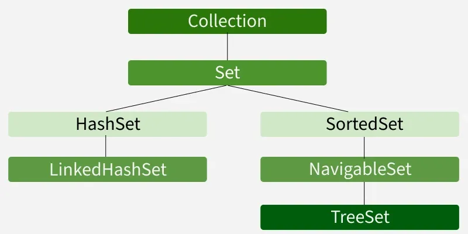
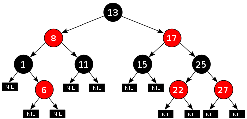

# TreeSet en Java

**Materia:** Diseño y Programación Orientada a Objetos

**Tema:** `java.util.TreeSet`

**Integrantes:** 
- Torres González Moisés Gerónimo - S25018144
- Cobaxin Miss Bryan de Jesús - S25018143

## 1.0 ¿Qué es un TreeSet?

Un `TreeSet` en Java es una estructura de datos que pertenece al *Java Collections Framework*. Es una implementación de la interfaz `NavigableSet` (que a su vez hereda de `SortedSet` y `Set`). Su propósito principal es almacenar una colección de elementos garantizando que no existan datos duplicados y que todos se mantengan acomodados en un orden específico de forma automática.

Jerarquía de `TreeSet`:




### 1.1 Características principales

* **No permite elementos duplicados:** Si intentas agregar un valor que ya existe, la estructura simplemente lo ignora.


* **Ordenamiento automático:** Mantiene los elementos ordenados en todo momento tras cada inserción o eliminación.


* **No admite nulos:** A diferencia de otras colecciones, no permite almacenar valores `null`.


* **Decisión de igualdad:** Determina si un elemento es un duplicado usando el resultado del método `compareTo()` o `compare()`, ignorando el tradicional método `equals()`.


* **No es thread-safe:** Si se usa en entornos con múltiples hilos, requiere sincronización externa.


* **Usa genéricos:** Proporciona seguridad de tipos en tiempo de compilación.


---

## 2.0 ¿Cómo funciona por dentro?

Para lograr mantener todo ordenado de forma automática y rápida, el `TreeSet` no guarda los datos en un arreglo tradicional. En su lugar, utiliza una estructura de datos avanzada basada en nodos.

### 2.1 El Árbol Rojinegro (Red-Black Tree)

Detrás de escena, un `TreeSet` está respaldado por un `TreeMap`, el cual utiliza una estructura llamada **Árbol Rojinegro**.

Un Árbol Rojinegro es un árbol binario de búsqueda que **se auto-balancea**. Aplica reglas estrictas de "colores" a sus nodos (rojos o negros) para evitar deformarse:

1. La raíz del árbol siempre es negra.


2. Un nodo rojo nunca puede tener hijos rojos.


Cuando insertas o eliminas un dato, el árbol detecta si una de sus ramas está creciendo demasiado. Si es así, hace "rotaciones" y recolorea los nodos para reacomodarse automáticamente. Esto garantiza que la altura del árbol siempre se mantenga proporcional al logaritmo del número de elementos (`log n`), lo que asegura un rendimiento rápido y estable incluso en el peor de los casos.




---

## 3.0 Tipos de Ordenamiento

El `TreeSet` necesita saber bajo qué reglas debe acomodar los elementos. Para esto, Java ofrece dos enfoques principales.

### 3.1 Orden Natural (`Comparable`)

El orden natural ocurre cuando los propios objetos "saben" cómo ordenarse a sí mismos. Para lograrlo, la clase del objeto debe implementar la interfaz genérica `Comparable<T>` y sobrescribir su método `compareTo()`.

* **¿Cuándo se usa?** Cuando el objeto tiene un criterio de ordenamiento predeterminado que casi siempre será el mismo. Por ejemplo, la clase `String` y la clase `Integer` ya implementan `Comparable` por defecto (alfabético y numérico).


### 3.2 Comparator

Un `Comparator<T>` es un criterio de ordenamiento externo al objeto. Se implementa creando una clase separada que contenga el método `compare()` y se pasa como parámetro al constructor del `TreeSet`.

* **¿Cuándo se usa?** Cuando necesitas ordenar los objetos de una forma distinta a su orden natural. También es indispensable cuando quieres ordenar objetos de una clase que tú no creaste y que no puedes modificar para agregarle `Comparable`.


---

## 4.0 Los Métodos de Navegación y Complejidad

Gracias a la estructura auto-balanceada del Árbol Rojinegro, las operaciones principales tienen una complejidad temporal de **O(log n)**, lo que las hace extremadamente eficientes.

### 4.1 ¿Qué son los métodos de navegación?

Al implementar la interfaz `NavigableSet`, el `TreeSet` adquiere herramientas de búsqueda relativa llamadas "métodos de navegación". A diferencia de una búsqueda tradicional donde necesitas el valor exacto, los métodos de navegación te permiten hacer consultas de aproximación o trabajar con rangos. Sirven para responder preguntas como: *"¿Cuál es el valor más cercano a X?"* o *"Dame todos los elementos mayores a Y"*.

### 4.2 Métodos de `TreeSet`

| Método | Descripción | Complejidad Temporal |
| :--- | :--- | :--- |
| `add(E e)` | Inserta el elemento en la posición correcta si no existe. | **O(log n)** |
| `addAll(Collection<? extends E> c)` | Añade todos los elementos de una colección al conjunto. | **O(m log n)** |
| `ceiling(E e)` | Devuelve el elemento menor o igual / mayor o igual a `e`. | **O(log n)** |
| `clear()` | Elimina absolutamente todos los elementos del conjunto. | **O(n)** |
| `clone()` | Devuelve una copia superficial (shallow copy) del `TreeSet`. | **O(n)** |
| `comparator()` | Devuelve el `Comparator` usado, o `null` si usa el orden natural. | **O(1)** |
| `contains(Object o)` | Devuelve `true` si el conjunto contiene el elemento. | **O(log n)** |
| `descendingIterator()` | Devuelve un iterador sobre los elementos en orden descendente. | **O(1)** |
| `descendingSet()` | Devuelve una vista en orden inverso de los elementos. | **O(1)** *(Vista)* |
| `first()` | Devuelve el elemento menor (primero). | **O(log n)** |
| `floor(E e)` | Devuelve el elemento menor o igual / mayor o igual a `e`. | **O(log n)** |
| `headSet(E toElement)` | Devuelve una vista de elementos estrictamente menores a `toElement`. | **O(1)** *(Vista)* |
| `headSet(E toElement, boolean inclusive)` | Devuelve una vista de elementos menores (o iguales, si es true) a `toElement`. | **O(1)** *(Vista)* |
| `higher(E e)` | Devuelve el elemento estrictamente mayor a `e`. | **O(log n)** |
| `isEmpty()` | Devuelve `true` si el conjunto no contiene elementos. | **O(1)** |
| `iterator()` | Devuelve un iterador sobre los elementos en orden ascendente. | **O(1)** |
| `last()` | Devuelve el elemento mayor (último). | **O(log n)** |
| `lower(E e)` | Devuelve el elemento estrictamente menor a `e`. | **O(log n)** |
| `pollFirst()` | Recupera y elimina el elemento menor del conjunto. | **O(log n)** |
| `pollLast()` | Recupera y elimina el elemento mayor del conjunto. | **O(log n)** |
| `remove(Object o)` | Elimina el elemento especificado del conjunto. | **O(log n)** |
| `size()` | Devuelve la cantidad de elementos en el conjunto. | **O(1)** |
| `spliterator()` | Crea un `Spliterator` de enlace tardío (late-binding) y de tipo fail-fast. | **O(1)** |
| `subSet(E fromElement, E toElement)` | Devuelve una vista del conjunto en el rango `[fromElement, toElement)`. | **O(1)** *(Vista)* |
| `subSet(E from, boolean fromInc, E to, boolean toInc)` | Devuelve una vista especificando si los límites son inclusivos o exclusivos. | **O(1)** *(Vista)* |
| `tailSet(E fromElement)` | Devuelve una vista de elementos mayores o iguales a `fromElement`. | **O(1)** *(Vista)* |
| `tailSet(E fromElement, boolean inclusive)` | Devuelve una vista de elementos mayores (o iguales, si es true) a `fromElement`. | **O(1)** *(Vista)* |

---

## 5.0 Ejemplos en Código
### 5.1 Clase base y el porqué del `compareTo`

Cuando implementamos `Comparable`, Java nos obliga a sobrescribir (utilizar `@Override`) el método `compareTo`. Hacemos esto por dos razones críticas:

1. **Definir la regla de orden:** Le decimos a Java matemáticamente qué objeto es "mayor" y cuál es "menor".
2. **Evitar la pérdida de datos:** Si dos estudiantes tienen el mismo promedio y la función devuelve `0`, el `TreeSet` asume que son **el mismo objeto duplicado** y descarta al segundo. Por eso sobrescribimos el método para agregar un criterio de desempate.


```java
// Implementamos Comparable para definir el orden por defecto
class Estudiante implements Comparable<Estudiante> {
    private String nombre;
    private double promedio;

    public Estudiante(String nombre, double promedio) {
        this.nombre = nombre;
        this.promedio = promedio;
    }

    public String getNombre() { return nombre; }
    public double getPromedio() { return promedio; }

    // Sobrescribimos compareTo 
    @Override
    public int compareTo(Estudiante otro) {
        // Ordenamos de mayor a menor promedio
        if (this.promedio > otro.promedio) return -1;
        if (this.promedio < otro.promedio) return 1;
        
        // Criterio de desempate. 
        // Si el promedio es idéntico, comparamos por nombre para evitar que el TreeSet crea que son duplicados y los borre.
        return this.nombre.compareTo(otro.nombre);
    }

    @Override
    public String toString() {
        return nombre + " (" + promedio + ")";
    }
}

```

### 5.2 Implementando un `Comparator` externo

```java
import java.util.Comparator;

class ComparadorPorNombre implements Comparator<Estudiante> {
    @Override
    public int compare(Estudiante a, Estudiante b) {

        // Ignoramos el promedio y usamos orden alfabético tradicional
        return a.getNombre().compareTo(b.getNombre());
    }
}

```

### 5.3 Implementación principal y pruebas

```java
import java.util.TreeSet;

public class MainTreeSet {
    public static void main(String[] args) {
        
        // Utilizando el Orden Natural
        System.out.println("--- Orden Natural (Por Promedio) ---");
        TreeSet<Estudiante> conjuntoNatural = new TreeSet<>();
        
        conjuntoNatural.add(new Estudiante("Ana", 9.5));
        conjuntoNatural.add(new Estudiante("Luis", 8.7));
        conjuntoNatural.add(new Estudiante("Carlos", 9.5)); 
        conjuntoNatural.add(new Estudiante("Beto", 7.2));
    
        conjuntoNatural.add(new Estudiante("Luis", 8.7)); // duplicado
        
        for (Estudiante e : conjuntoNatural) {
            System.out.println(e);
        }

        // Utilizando el Comparator
        System.out.println("\n--- Orden Personalizado (Por Nombre) ---");
        TreeSet<Estudiante> conjuntoNombres = new TreeSet<>(new ComparadorPorNombre());
        
        conjuntoNombres.add(new Estudiante("Luis", 8.7));
        conjuntoNombres.add(new Estudiante("Ana", 9.5));
        conjuntoNombres.add(new Estudiante("Carlos", 9.5));
        conjuntoNombres.add(new Estudiante("Beto", 7.2));
        
        for (Estudiante e : conjuntoNombres) {
            System.out.println(e);
        }

```

**Salida en consola:**

```text
--- Orden Natural (Por Promedio) ---
Ana (9.5)
Carlos (9.5)
Luis (8.7)
Beto (7.2)

--- Orden Personalizado (Por Nombre) ---
Ana (9.5)
Beto (7.2)
Carlos (9.5)
Luis (8.7)

```

### 5.4 Probando los métodos de navegación

```java
        // Pruebas de Navegación
        System.out.println("\n--- Navegación Relativa ---");
        TreeSet<Integer> numeros = new TreeSet<>();
        numeros.add(10); numeros.add(20); numeros.add(30); numeros.add(40); numeros.add(50);

        System.out.println("Conjunto base: " + numeros);
        
        // Consultas de extremos y aproximaciones
        System.out.println("Elemento más pequeño (first): " + numeros.first());
        System.out.println("Elemento más grande (last): " + numeros.last());
        System.out.println("Inmediato mayor o igual a 25 (ceiling): " + numeros.ceiling(25)); 
        System.out.println("Inmediato menor estrictamente a 30 (lower): " + numeros.lower(30)); 
        
        // Consultas por rangos
        System.out.println("Rango del 20 al 40 exclusivo (subSet): " + numeros.subSet(20, 40));
        System.out.println("Menores a 30 (headSet): " + numeros.headSet(30));
        System.out.println("Mayores o iguales a 30 (tailSet): " + numeros.tailSet(30));
        
        // Extracción de datos
        System.out.println("Extrayendo el menor (pollFirst): " + numeros.pollFirst()); 
        System.out.println("Extrayendo el mayor (pollLast): " + numeros.pollLast()); 
        
        System.out.println("Conjunto final: " + numeros);
    }
}

```

**Salida en consola:**

```text
--- Navegación Relativa ---
Conjunto base: [10, 20, 30, 40, 50]
Elemento más pequeño (first): 10
Elemento más grande (last): 50
Inmediato mayor o igual a 25 (ceiling): 30
Inmediato menor estrictamente a 30 (lower): 20
Rango del 20 al 40 exclusivo (subSet): [20, 30]
Menores a 30 (headSet): [10, 20]
Mayores o iguales a 30 (tailSet): [30, 40, 50]
Extrayendo el menor (pollFirst): 10
Extrayendo el mayor (pollLast): 50
Conjunto final: [20, 30, 40]

```

---

## 6.0 Conclusiones

Un `TreeSet` es la estructura ideal dentro de Java cuando se necesita almacenar colecciones libres de elementos duplicados que exigen estar permanentemente ordenadas. Al estar gestionado internamente por un Árbol Rojinegro, permite realizar operaciones de búsqueda, inserción y eliminación con una eficiencia logarítmica de O(log n), superando con creces a las listas tradicionales cuando se trata de conjuntos de datos que requieren orden en tiempo real.

Comprender y dominar el `TreeSet` implica no solo conocer sus métodos de navegación para realizar consultas relativas y por rangos (`subSet`, `ceiling`, `floor`), sino también aplicar conceptos clave de Programación Orientada a Objetos, como la sobrescritura obligatoria de métodos, el polimorfismo y la separación de responsabilidades mediante la correcta implementación de interfaces como `Comparable` y `Comparator`.

## Fuentes

- GeeksforGeeks. (s.f.). *TreeSet in Java with Examples*. Recuperado de https://www.geeksforgeeks.org/java/treeset-in-java-with-examples/